# Execution Plan

## Project Overview
- **Project Name**: 테이블오더 서비스 (Table Order Service)
- **Project Type**: Greenfield
- **Complexity**: Medium-Complex
- **Target Scale**: 소규모 (1-50 테이블, 단일 매장)

---

## Detailed Analysis Summary

### Change Impact Assessment
| 영역 | 영향 | 설명 |
|------|------|------|
| **User-facing changes** | Yes | 고객용/관리자용 완전히 새로운 UI |
| **Structural changes** | Yes | 새로운 Modular Monolith 아키텍처 |
| **Data model changes** | Yes | 9개 핵심 엔티티 설계 필요 |
| **API changes** | Yes | 모든 API 신규 개발 |
| **NFR impact** | Yes | Security Extension 활성화, 성능 요구사항 |

### Risk Assessment
| 항목 | 수준 | 근거 |
|------|------|------|
| **Risk Level** | Medium | 신규 프로젝트, 명확한 요구사항, 검증된 기술 스택 |
| **Rollback Complexity** | Low | 신규 개발이므로 롤백 불필요 |
| **Testing Complexity** | Moderate | 실시간 SSE, 세션 관리 등 테스트 필요 |

---

## Workflow Visualization

```mermaid
flowchart TD
    Start(["User Request"])
    
    subgraph INCEPTION["🔵 INCEPTION PHASE"]
        WD["Workspace Detection<br/><b>COMPLETED</b>"]
        RA["Requirements Analysis<br/><b>COMPLETED</b>"]
        US["User Stories<br/><b>COMPLETED</b>"]
        WP["Workflow Planning<br/><b>COMPLETED</b>"]
        AD["Application Design<br/><b>EXECUTE</b>"]
        UG["Units Generation<br/><b>EXECUTE</b>"]
    end
    
    subgraph CONSTRUCTION["🟢 CONSTRUCTION PHASE"]
        FD["Functional Design<br/><b>EXECUTE</b>"]
        NFRA["NFR Requirements<br/><b>EXECUTE</b>"]
        NFRD["NFR Design<br/><b>EXECUTE</b>"]
        ID["Infrastructure Design<br/><b>EXECUTE</b>"]
        CG["Code Generation<br/><b>EXECUTE</b>"]
        BT["Build and Test<br/><b>EXECUTE</b>"]
    end
    
    subgraph OPERATIONS["🟡 OPERATIONS PHASE"]
        OPS["Operations<br/><b>PLACEHOLDER</b>"]
    end
    
    Start --> WD
    WD --> RA
    RA --> US
    US --> WP
    WP --> AD
    AD --> UG
    UG --> FD
    FD --> NFRA
    NFRA --> NFRD
    NFRD --> ID
    ID --> CG
    CG --> BT
    BT -.-> OPS
    BT --> End(["Complete"])
    
    style WD fill:#4CAF50,stroke:#1B5E20,stroke-width:3px,color:#fff
    style RA fill:#4CAF50,stroke:#1B5E20,stroke-width:3px,color:#fff
    style US fill:#4CAF50,stroke:#1B5E20,stroke-width:3px,color:#fff
    style WP fill:#4CAF50,stroke:#1B5E20,stroke-width:3px,color:#fff
    style AD fill:#FFA726,stroke:#E65100,stroke-width:3px,stroke-dasharray: 5 5,color:#000
    style UG fill:#FFA726,stroke:#E65100,stroke-width:3px,stroke-dasharray: 5 5,color:#000
    style FD fill:#FFA726,stroke:#E65100,stroke-width:3px,stroke-dasharray: 5 5,color:#000
    style NFRA fill:#FFA726,stroke:#E65100,stroke-width:3px,stroke-dasharray: 5 5,color:#000
    style NFRD fill:#FFA726,stroke:#E65100,stroke-width:3px,stroke-dasharray: 5 5,color:#000
    style ID fill:#FFA726,stroke:#E65100,stroke-width:3px,stroke-dasharray: 5 5,color:#000
    style CG fill:#4CAF50,stroke:#1B5E20,stroke-width:3px,color:#fff
    style BT fill:#4CAF50,stroke:#1B5E20,stroke-width:3px,color:#fff
    style OPS fill:#BDBDBD,stroke:#424242,stroke-width:2px,stroke-dasharray: 5 5,color:#000
    style INCEPTION fill:#BBDEFB,stroke:#1565C0,stroke-width:3px,color:#000
    style CONSTRUCTION fill:#C8E6C9,stroke:#2E7D32,stroke-width:3px,color:#000
    style OPERATIONS fill:#FFF59D,stroke:#F57F17,stroke-width:3px,color:#000
    style Start fill:#CE93D8,stroke:#6A1B9A,stroke-width:3px,color:#000
    style End fill:#CE93D8,stroke:#6A1B9A,stroke-width:3px,color:#000
    
    linkStyle default stroke:#333,stroke-width:2px
```

---

## Phases to Execute

### 🔵 INCEPTION PHASE
| 단계 | 상태 | 근거 |
|------|------|------|
| Workspace Detection | ✅ COMPLETED | Greenfield 프로젝트 확인 |
| Reverse Engineering | ⏭️ SKIPPED | Greenfield - 기존 코드 없음 |
| Requirements Analysis | ✅ COMPLETED | 기술 스택, 기능/비기능 요구사항 정의 |
| User Stories | ✅ COMPLETED | 32개 스토리, 2개 페르소나 |
| Workflow Planning | ✅ COMPLETED | 현재 단계 |
| **Application Design** | 🔶 EXECUTE | 새로운 컴포넌트/서비스 설계 필요, 모듈 구조 정의 필요 |
| **Units Generation** | 🔶 EXECUTE | 복수 모듈 (Backend, Customer Frontend, Admin Frontend), 병렬 개발 가능한 단위 분할 필요 |

### 🟢 CONSTRUCTION PHASE
| 단계 | 상태 | 근거 |
|------|------|------|
| **Functional Design** | 🔶 EXECUTE | 비즈니스 로직 설계 필요 (세션 관리, 주문 플로우, 상태 머신) |
| **NFR Requirements** | 🔶 EXECUTE | Security Extension 활성화, 성능 요구사항 존재 |
| **NFR Design** | 🔶 EXECUTE | 보안 패턴, 인증/인가 설계 필요 |
| **Infrastructure Design** | 🔶 EXECUTE | AWS EKS Automode, S3, PostgreSQL 인프라 설계 |
| **Code Generation** | 🔶 EXECUTE | 항상 실행 - 구현 필수 |
| **Build and Test** | 🔶 EXECUTE | 항상 실행 - 빌드/테스트 지침 |

### 🟡 OPERATIONS PHASE
| 단계 | 상태 | 근거 |
|------|------|------|
| Operations | ⏸️ PLACEHOLDER | 향후 배포/모니터링 워크플로우 |

---

## Execution Summary

### 실행할 단계: 10개
1. ✅ Workspace Detection (완료)
2. ✅ Requirements Analysis (완료)
3. ✅ User Stories (완료)
4. ✅ Workflow Planning (완료)
5. 🔶 Application Design
6. 🔶 Units Generation
7. 🔶 Functional Design (per-unit)
8. 🔶 NFR Requirements (per-unit)
9. 🔶 NFR Design (per-unit)
10. 🔶 Infrastructure Design (per-unit)
11. 🔶 Code Generation (per-unit)
12. 🔶 Build and Test

### 건너뛸 단계: 1개
1. ⏭️ Reverse Engineering (Greenfield이므로 해당 없음)

---

## Anticipated Unit Structure

Application Design과 Units Generation에서 다음과 같은 구조가 예상됩니다:

### 예상 Units (확정은 Application Design 후)
| Unit | 설명 | 기술 스택 |
|------|------|----------|
| **Backend API** | Spring Boot Modular Monolith | Java, Spring Boot, PostgreSQL |
| **Customer Frontend** | 고객용 주문 앱 | React, TypeScript |
| **Admin Frontend** | 관리자용 대시보드 | React, TypeScript |

### Per-Unit Construction Loop
각 Unit에 대해 다음 단계가 반복됩니다:
1. Functional Design → NFR Requirements → NFR Design → Infrastructure Design → Code Generation
2. 모든 Unit 완료 후 Build and Test

---

## Success Criteria

### Primary Goal
- 테이블오더 MVP 완성: 고객 주문 + 관리자 모니터링 + 메뉴 관리

### Key Deliverables
- [ ] Backend API (Spring Boot)
- [ ] Customer Frontend (React)
- [ ] Admin Frontend (React)
- [ ] Database Schema (PostgreSQL)
- [ ] Infrastructure Configuration (AWS EKS, S3)
- [ ] Build & Test Instructions

### Quality Gates
- [ ] Security Extension 규칙 준수
- [ ] 32개 User Story의 Acceptance Criteria 충족
- [ ] API 응답 < 500ms, SSE 지연 < 2초
- [ ] 빌드 성공 및 테스트 통과

---

## Estimated Timeline

| Phase | 단계 수 | 예상 |
|-------|---------|------|
| INCEPTION (remaining) | 2 | Application Design + Units Generation |
| CONSTRUCTION | 6 | Per-unit design + Code + Build/Test |
| **Total** | 8 | 전체 남은 단계 |

---

## Next Steps

1. **Application Design**: 컴포넌트 식별, 서비스 레이어 설계, 모듈 구조 정의
2. **Units Generation**: 개발 단위 분할 및 의존성 정의
3. **Construction Loop**: 각 Unit별 설계 → 구현 → 테스트
